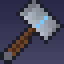
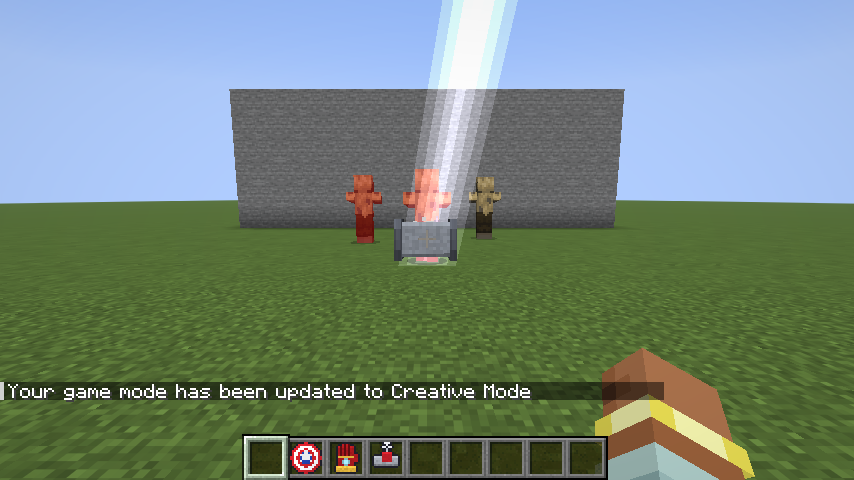
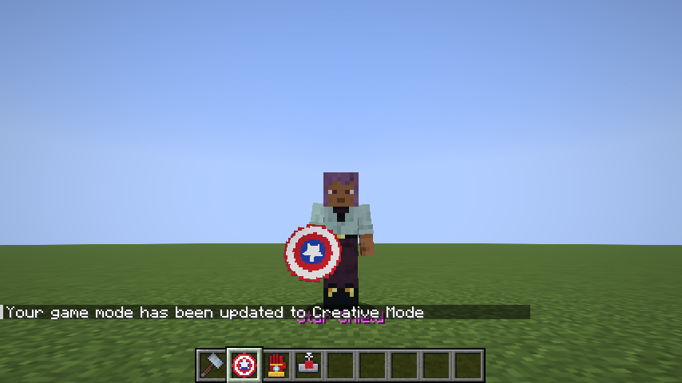
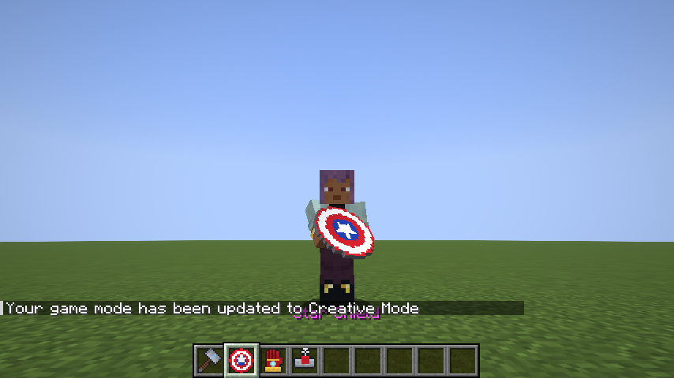
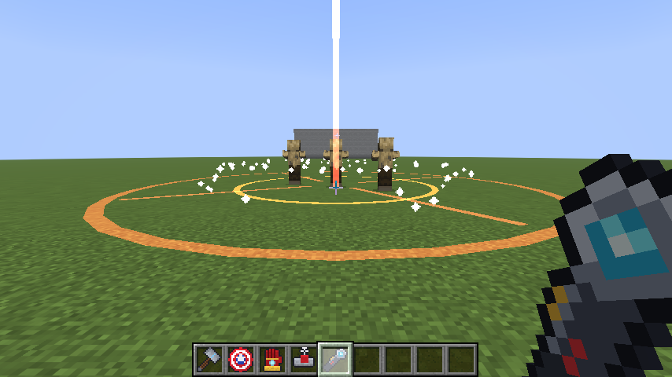
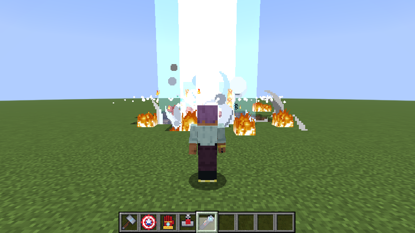
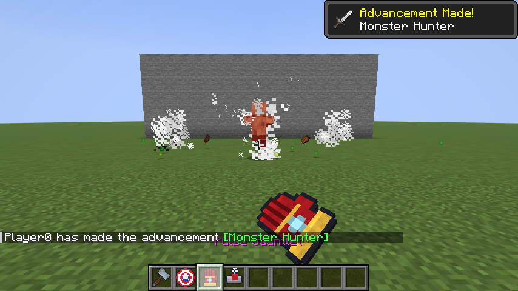
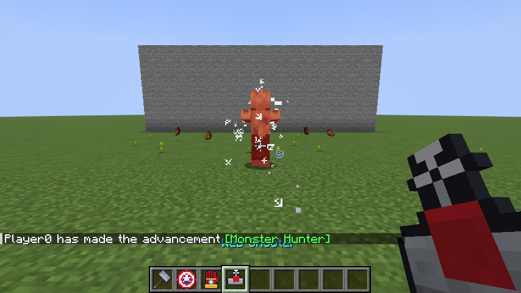

# Minecraft Mods

A collection of Minecraft mods and shader packs. Each top-level folder is a separate project with its own Gradle build, so you can build or change one without touching the others.

| Mod | What it adds | Loader | Minecraft |
| --- | --- | --- | --- |
| [**Hero Arsenal**](hero-arsenal/) | Superhero gear: a lightning hammer, a ricochet shield, a blaster gauntlet, web shooters and an orbital laser | Fabric | 26.3 |
| [**Blockshine Shaders**](blockshine/) | Fast BSL-style shader pack: glassy reflective water, soft clouds, god rays, lens flare, golden sunsets. About 1.5× BSL's FPS in our test | Iris | 26.3 |
| [**BlockOS Computers**](blockos/) | Placeable computers with a desktop, apps and games, and BlockScript programs that control redstone, sense the world and talk wirelessly | Fabric | 26.3 |
| [**Mac FPS Boost**](mac-fps-boost/) | Stops macOS rendering at Retina resolution (4× fewer pixels) | Fabric | 26.3 |

---

##  Hero Arsenal

Five superhero weapons. Most have a main ability on **right-click** and a second one on **sneak + right-click**. You'll find them all in the **Combat** creative tab.



### ⚡ Mjolnir
| Do this | What happens |
| --- | --- |
| Hold right-click, then let go | You wind it up over your head while sparks build up, then throw it. It tumbles through the air, calls lightning on whatever it hits, then flies back into your hand. A full 1-second charge throws it harder. |
| Sneak + right-click | Calls lightning wherever you're looking, up to 64 blocks away. |
| Melee | 12 damage. Critical hits always call lightning, and normal hits do 20% of the time. |

Your own lightning never hurts you. It does hit everything else nearby: it sets mobs on fire, charges creepers and turns pigs into zombie piglins. It never sets blocks on fire.

### 🛡️ Star Shield
| Do this | What happens |
| --- | --- |
| Hold right-click | Blocks attacks like a normal shield. It never breaks. |
| Sneak + right-click | Throws it. It bounces from enemy to enemy and off walls (up to 4 bounces), then comes back. |

<p>
  
  
</p>

### 🔥 Pulse Gauntlet
| Do this | What happens |
| --- | --- |
| Right-click | Fires a 40-block energy beam. It does 8 damage, knocks mobs back and sets them on fire. |
| Sneak + right-click | Thrusters launch you where you're looking. Chain them to fly. |

While it's in your hand, you take no fall damage.

### 🕸️ Web Shooter
| Do this | What happens |
| --- | --- |
| Right-click a mob | It gets stuck in webs (heavy slowness and weakness for 5 seconds). |
| Right-click a block | Pulls you toward that block, so you can swing around. |

While it's in your hand, you take no fall damage.

### 🛰️ Orbital Laser
| Do this | What happens |
| --- | --- |
| Right-click a block (up to 128 blocks away) | Marks the spot. A glowing target ring charges up for 2.5 seconds with rising sparks and warning beeps, then a plasma beam hits from the sky. |

The beam blasts a crater about 12 blocks wide, sets the ground on fire and throws back and burns every mob within 8 blocks (up to 28 damage in the middle). The blast never hurts you, but watch out for the fire and the drop. 15-second cooldown. Bedrock, obsidian and other blast-proof blocks survive, and it won't break blocks in spawn protection, in adventure mode, or when the `tnt_explodes` game rule is off.

<p>
  
  
</p>

<p>
  
  
</p>

### Install
1. Use a **Fabric** instance for Minecraft **26.3** (in Prism Launcher, for example) with **Fabric API** installed.
2. Download [`hero-arsenal-1.1.0.jar`](https://xandertaylorx.github.io/minecraft-mods/downloads/) from the site and put it in the instance's `mods` folder.

Mod page: **https://xandertaylorx.github.io/minecraft-mods/mods/hero-arsenal/**

---

## Building

Requires **Java 25**. Each mod comes with its own Gradle wrapper, so you don't need to install Gradle.

```bash
cd hero-arsenal
./gradlew build
```

The jar ends up in `<mod>/build/libs/`.

### Automated in-game test

Hero Arsenal has a test that launches a real Minecraft client, creates a world and uses every item on test mobs. It checks that each item works and saves screenshots along the way:

```bash
cd hero-arsenal
./gradlew runClientGameTest
```

Results are printed as `HA-TEST PASS/FAIL` lines, and screenshots go to `build/run/clientGameTest/screenshots/`. The screenshots in this README come from that test.

## Website: XanderCraft

**Live at https://xandertaylorx.github.io/minecraft-mods/**

[`web/`](web/) is the XanderCraft site: a hub that lists every mod and pack, with its own page for each mod. It's plain HTML and CSS with no build step, and it deploys to GitHub Pages automatically whenever `web/` changes on `main`.

```
web/
├── index.html              # hub: hero banner, a card for each mod/pack, install steps
├── css/site.css            # shared styles for every page
├── img/                    # site textures (deepslate, grass, dirt, terrain banner)
├── downloads/              # the actual .jar/.zip files + the Downloads page
└── mods/
    └── hero-arsenal/       # one folder per mod: index.html + img/
```

**Publishing a new version:** build it, copy the jar from `<mod>/build/libs/` into `web/downloads/`, add a row to `web/downloads/index.html`, and update the download links on the mod's page and home page card. Downloads come straight from the site, not from GitHub.

**Adding a mod to the site:** copy `web/mods/hero-arsenal/` to a new folder and edit it, then copy one of the cards in `web/index.html`. The shader pack already has a "Coming soon" card waiting.

To preview locally:

```bash
python3 -m http.server 8099 --directory web
```

Then open http://localhost:8099.

## Adding a new mod

Create a new top-level folder with its own Fabric project. Copying `hero-arsenal/` and renaming the mod ID, package and assets is the quickest start. Then add a row to the table at the top.
