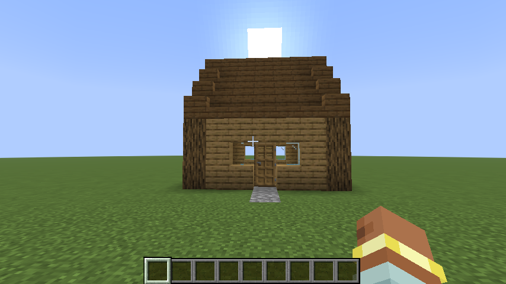

# 🤖 Agent Bridge

Lets an AI agent like **Claude Code** or **Codex** see and build in your Minecraft world. You turn it on in game, connect your AI once, and then just ask: *"build a cozy cottage next to me"*. You watch it happen live.



*Claude Code built this from one prompt. It checked the ground, built the cottage in one go, then moved the camera and took a screenshot to check its work.*

Under the hood, the mod runs a small [MCP](https://modelcontextprotocol.io) server inside the game. MCP is the standard way AI agents connect to outside tools.

## Quick start

1. Put `agent-bridge-1.0.0.jar` in your `mods` folder, next to Fabric API (Minecraft 26.3).
2. Open a world and type **`/agent on`**. You need cheats on, or op on a server.
3. Click **[Copy Claude Code command]** in chat, paste it into a terminal and press Enter. You only do this once, because the token stays the same between launches.
4. Start `claude` and ask it to build something.

For **Codex**, click **[Copy Codex config]** instead and paste it into `~/.codex/config.toml`. It looks like this:

```toml
[mcp_servers.minecraft]
url = "http://127.0.0.1:25599/mcp"
http_headers = { Authorization = "Bearer <your token>" }
```

## Commands

| Command | What it does |
| --- | --- |
| `/agent on` | Starts the bridge. The agent acts for whoever ran it. |
| `/agent off` | Stops it. The agent can't reach the game until you turn it back on. |
| `/agent status` | Shows whether it's on, and which AI last connected. |
| `/agent setup` | Shows the copy-to-clipboard connect buttons again. |
| `/agent undo [steps]` | Undoes the agent's last builds yourself. |
| `/agent newtoken` | Makes a new secret token. Old connections stop working. |

The bridge is **off every time you start the game**. While it's on, the game stops pausing when you click into another window, so you can talk to your AI and still see blocks appear. Your normal setting comes back when you turn it off.

## What the AI can do

| Tool | What it does |
| --- | --- |
| `get_status` | Where you are and what you're looking at, plus game mode, health, held item, time, weather and build height |
| `get_surface` | A top-down height map of the ground, so builds sit on the terrain |
| `scan_area` | Reads every block in a box, layer by layer, so the AI can "see" a build |
| `get_entities` | Mobs, animals, items and players nearby |
| `build_structure` | Builds a whole structure in one call from a palette and text layers |
| `fill` | Fills a box: solid, hollow, outline, only air, or only one block type |
| `set_blocks` | Places single blocks for details |
| `undo` | Reverts the AI's last builds |
| `run_command` | Runs a game command like `/time`, `/summon` or `/give` |
| `move_player` | Teleports you, or turns your camera to face a point |
| `say` | Sends a chat message with the AI's name |
| `screenshot` | Lets the AI see your screen to check its work |

The action bar shows what the agent is doing as it works, for example `🤖 Claude: built 188 blocks`.

## Safety

- **Only your computer can connect.** The server listens on `127.0.0.1` only, and every request needs the secret token.
- **Web pages can't reach it.** Requests from browser pages that aren't on localhost are rejected.
- **Commands are limited.** `run_command` has game-master permission, so it can use `/fill`, `/tp` or `/give`, but not `/op`, `/stop` or `/ban`, and it can't run `/agent`.
- **Builds can be undone.** The last 50 build actions can be reverted, either by the AI or with `/agent undo`. Changes made through `run_command` can't be undone.
- **It's only on when you say so.** Nothing listens until you type `/agent on`.

## Settings

`config/agent-bridge.json`:

| Setting | Default | What it does |
| --- | --- | --- |
| `port` | `25599` | Port the bridge listens on |
| `token` | random | The secret the AI must send |
| `maxBlocksPerCall` | `200000` | Most blocks one tool call may change |
| `maxScanVolume` | `32768` | Largest box `scan_area` reads (32×32×32) |
| `undoHistory` | `50` | How many build actions undo remembers |
| `allowCommands` | `true` | Turn off to disable `run_command` |
| `showActivity` | `true` | Show agent activity in the action bar |

## Notes

- It works in single-player, on a LAN world you're hosting, and on a dedicated server running the mod. On a dedicated server the bridge runs on the server machine, and screenshots don't work.
- Undo restores blocks but not the items inside containers.
- Big builds use a lot of the AI's tokens. `build_structure` and `fill` keep it efficient.

## Building and testing

```bash
./gradlew build
```

The jar ends up in `build/libs/`.

```bash
./gradlew runClientGameTest
```

This opens a real world, turns the bridge on and calls every tool over HTTP, the same way an AI client would. It runs 24 checks and prints them as `AB-TEST` lines. Set `AGENT_BRIDGE_LIVE=1` to keep the world open for a real AI: the URL and token go to `build/run/clientGameTest/agent-bridge-live.txt`, and the test ends once you create `build/run/clientGameTest/agent-bridge-done`.
