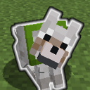
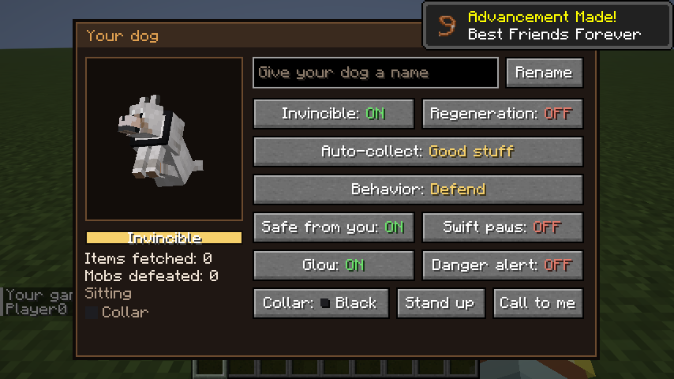
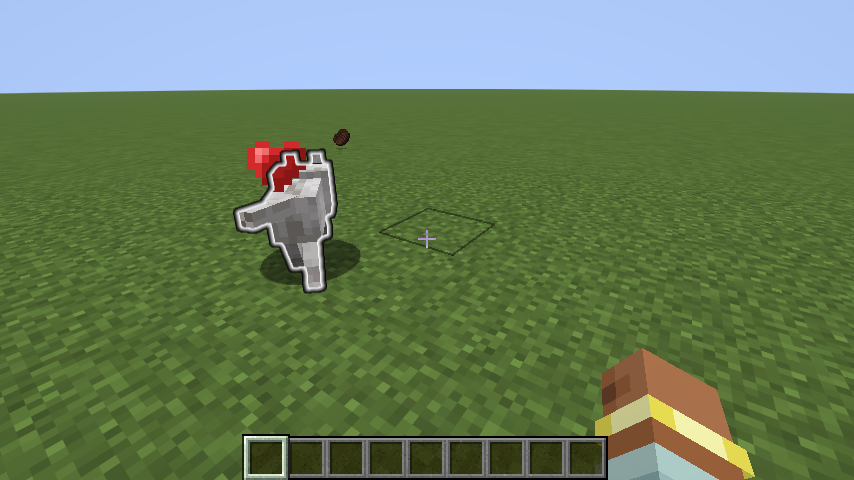
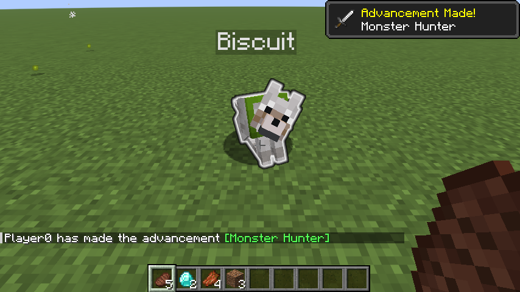

#  Better Dogs

**Sneak + right-click your tamed dog** to open its settings. Every dog keeps its own settings, saved with the world. A normal right-click still makes it sit or stand.

| Setting | What it does |
| --- | --- |
| **Invincible** | Nothing can hurt your dog: mobs, lava, fire, falling, drowning, explosions. Only `/kill` and the void still work. |
| **Auto-collect** | Picks up dropped items within about 20 blocks of you and brings them into your inventory. **Off**, **Food only**, **Good stuff** or **Everything**. |
| **Behavior** | **Defend** (normal dog), **Guard** (also hunts hostile mobs near you, but not creepers) or **Passive** (never fights). |
| **Regeneration** | Heals half a heart every 2 seconds. |
| **Safe from you** | Your own hits, arrows and explosions can't hurt it. On by default. |
| **Swift paws** | Runs 40% faster. |
| **Glow** | Outlined through walls so you can always find it. |
| **Danger alert** | Barks and makes hostile mobs near you glow for a few seconds. |
| **Name / Collar / Sit / Call to me** | Rename it, change the collar color, sit or stand, or teleport it to you. |

**Good stuff** means food plus ores, gems, ingots, coal, redstone, mob drops (bones, string, gunpowder, leather...), tools, armor, enchanted books and rare items. It skips dirt, cobblestone, seeds, rotten flesh and other junk. Your dog never picks up items you threw away yourself. If your inventory is full, fetched items are dropped at your feet.

The screen also shows the dog's health and how many items it has fetched and mobs it has defeated. Only the owner can open it.

  
  

### Install
1. Use a **Fabric** instance for Minecraft **26.3** with **Fabric API**.
2. Download [`better-dogs-1.0.0.jar`](https://xandertaylorx.github.io/minecraft-mods/downloads/) and put it in the instance's `mods` folder. In multiplayer, the server needs it too.

Mod page: **https://xandertaylorx.github.io/minecraft-mods/mods/better-dogs/**

### Test
`./gradlew runClientGameTest` starts a real client, tames a dog, opens the menu with sneak + right-click, clicks the buttons and checks every feature (28 checks, printed as `DOG-TEST PASS/FAIL`). Screenshots go to `build/run/clientGameTest/screenshots/`.
