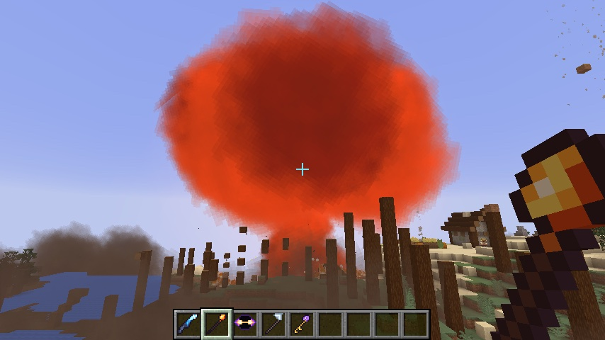
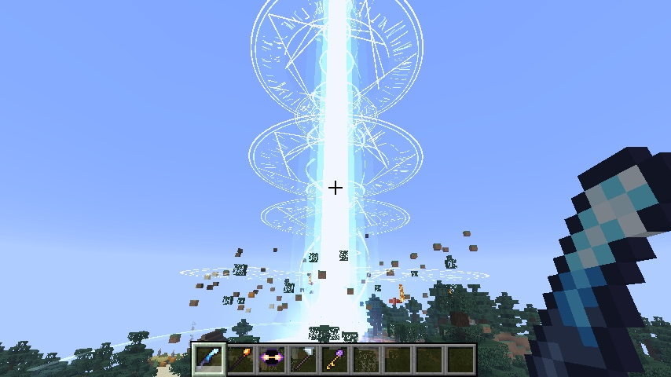
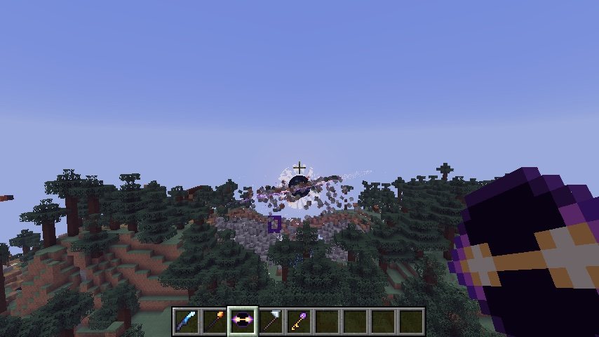
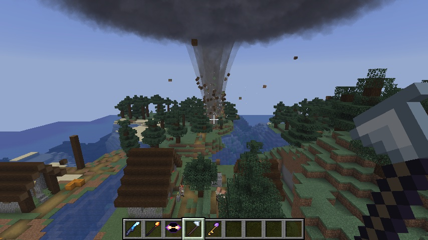
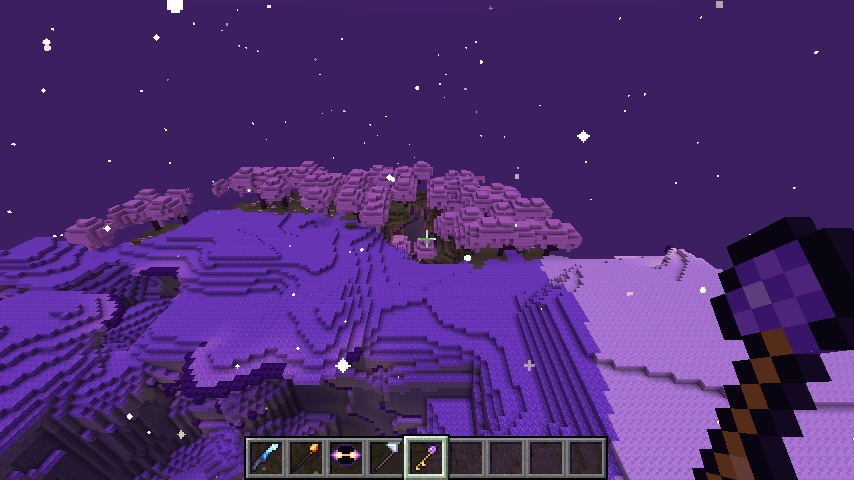

# Mass Destruction

Four weapons of mass destruction, and a third realm to escape to. A Fabric mod for Minecraft **26.3**. Its explosion, black hole and tornado follow the look of the spells in Small Magic: circles of runes written into the sky, a white instant when something goes off, and fire painted in a few tones from white through orange to smoke.

Everything is in the **Mass Destruction** creative tab, and each item can also be crafted.



## The weapons

| Item | Right-click | Sneak + right-click |
| --- | --- | --- |
| **Annihilator** | Marks a spot up to 200 blocks away. Rune circles are written into the sky above it for four seconds, then a beam about 20 blocks wide (counting its glow) comes down from orbit and burns an 18-block-deep crater. | |
| **Nova Rod** | Marks a spot up to 160 blocks away. Runes gather in the sky and the day turns red. Then a spark falls through the circles, everything goes white, and a fireball climbs into a mushroom cloud. A ring runs out along the ground, stripping trees and knocking over walls. | |
| **Singularity Core** | Opens a black hole over a spot up to 120 blocks away. It drags in mobs and items and tears up the ground block by block, spinning the blocks round its glowing disc. After 13 seconds it collapses and throws everything back out in a ring. | Shuts your black holes now, which makes them burst. |
| **Storm Caller** | Calls a tornado down on a spot up to 120 blocks away. A dark cloud winds up overhead and lightning brings the funnel down. While you hold the Storm Caller, the tornado goes wherever you point. It carries mobs up and throws them out, and tears up the ground. Over lava or fire it turns into a fire tornado; over water it becomes a waterspout. | Sends your tornadoes back up into the cloud. |

<p>
  
  
</p>
<p>
  
  
</p>

Your own weapons never hurt you. Breaking blocks follows the `tnt_explodes` game rule, spawn protection and adventure mode, just like TNT. Obsidian, crying obsidian and bedrock survive everything. Each weapon limits how many blocks it breaks per tick, so even the Annihilator doesn't freeze the game.

## The Rift

The Rift is a third realm alongside the Nether and the End: floating islands in a violet, starry sky that never gets light. It has three kinds of islands:

- **Crystal Wastes**: calcite and amethyst, with geodes.
- **Blossom Reach**: moss and cherry trees, with spore blossoms hanging underneath.
- **Ember Isles**: soul soil and magma, with soul fire.

The undersides of the islands drip with crying obsidian.

**How to get in:**

1. Build a frame of **crying obsidian** standing up, like a Nether portal. The inside must be at least 2 wide and 3 tall, and at most 21×21.
2. Open it with either:
   - a **Rift Key**: right-click the inside of the frame;
   - a **black hole**: open one within a few blocks of the frame.
3. Stand in the portal for two seconds.

You arrive at the same x and z on the other side. If there's no portal there, a new frame is built, standing on a small island of its own if there's only sky below.

## Recipes

| Item | Recipe |
| --- | --- |
| Annihilator | Nether star, beacon, 4 diamond blocks, 3 end rods |
| Nova Rod | Nether star, 2 blaze rods, 2 TNT, 2 fire charges |
| Singularity Core | Nether star, heavy core, 3 ender eyes, 4 crying obsidian |
| Storm Caller | Nether star, breeze rod, lightning rod, 4 wind charges |
| Rift Key | Ender eye, 3 amethyst shards, 2 gold ingots, crying obsidian |

## Install

1. Install [Fabric Loader](https://fabricmc.net/use/) for Minecraft 26.3, and [Fabric API](https://modrinth.com/mod/fabric-api).
2. Put `mass-destruction-1.0.0.jar` in your `mods` folder.

In multiplayer, install it on the server and on every player's game. The effects are drawn by the client, and the Rift has to exist on the server.

## Build and test

```bash
./gradlew build                # jar in build/libs
./gradlew runClientGameTest    # plays through everything in a real client
python3 tools/textures.py      # redraws every texture
```

The game test opens a real client in a village and fires every weapon at it. It then lights a portal, crosses into the Rift and comes back. Screenshots are saved in `build/run/clientGameTest/screenshots`, and each check prints as an `MD-TEST PASS` or `MD-TEST FAIL` line.
