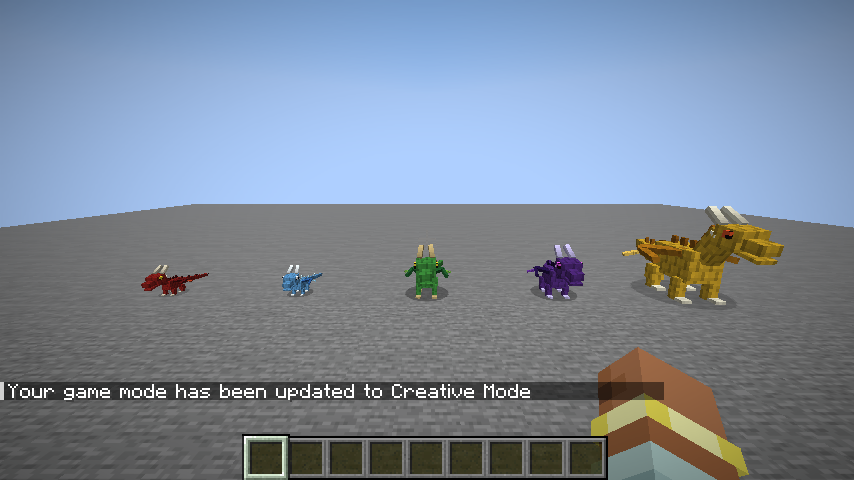
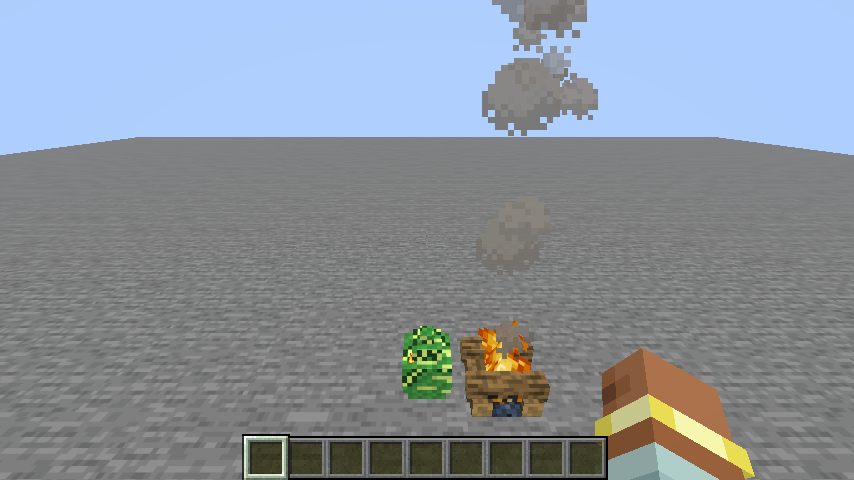
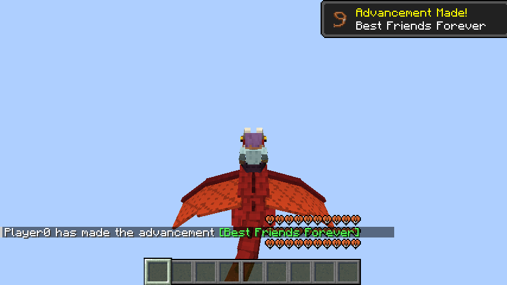

# Pet Dragons

Craft a dragon egg, keep it warm, and raise the hatchling into a dragon you can ride and fly. Five kinds, each with its own breath.



## Getting one

Craft an egg (diamonds in the corners, ender pearls on the sides, a colour item in the middle), place it, and put a heat source within two blocks: fire, a lit campfire, lava or a magma block. While it's warm it cracks in stages, then hatches a hatchling that is tame to the nearest player. Without heat it does nothing.

| Dragon | Centre of the recipe | Breath |
| --- | --- | --- |
| Ember | Magma block | Fire: burns mobs and sets the ground alight |
| Frost | Blue ice | Freezes and slows, turns water to ice, puts out fires |
| Verdant | Moss block | Poison |
| Void | Crying obsidian | Lifts enemies into the air with levitation |
| Sun | Glowstone | Blinds and makes enemies glow |



## Raising it

| Stage | Size | What it can do |
| --- | --- | --- |
| Hatchling | Small, big head | Follows you and sits when told |
| Juvenile (after 4 minutes) | Medium | Can be ridden on the ground, breathes |
| Adult (after 12 minutes) | Large | Flies |

Feed it any raw meat or fish to heal it and skip a minute of growing.

| Do this | What happens |
| --- | --- |
| Right-click with food | Feeds it |
| Sneak + right-click | Sit or stand |
| Right-click with an empty hand | Ride (juvenile and adult) |
| Jump while riding an adult | Take off. It hovers when you stop. |
| Look up or down while moving forward | Climb or dive |
| Sprint | Go faster |
| Hold **R** (rebindable) | Breathe. Your dragon gets a breath meter, so it can't breathe forever. |

Dragons fight for you without a rider: they attack what attacks you, and use their breath on targets in range.



## Building

```bash
./gradlew build
```

The jar is in `build/libs`. `./gradlew runClientGameTest` plays through hatching, riding, flight and breath in a real client and saves screenshots.

The model and skins are generated: `python3 tools/gen_dragon.py` rewrites the dragon model and its five textures, and `python3 tools/gen_assets.py` rewrites the eggs' textures, models and recipes.
