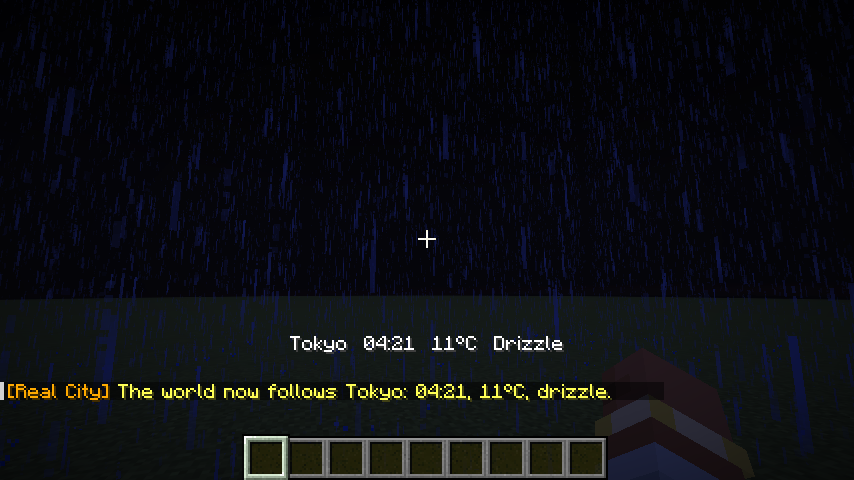

#  Real City

Type **`/setcity Manchester, UK`** and your Minecraft world follows that city: the **time of day**, **sunrise and sunset**, the **moon phase** and the **weather** all come from the real thing, live.

| Command | What it does |
| --- | --- |
| `/setcity <city>` | Picks the city. Add a country or state if there are several, like `/setcity Manchester, UK` or `/setcity Los Angeles`. |
| `/city` | Shows the city, its local time, weather, temperature, sunrise and sunset and the moon phase. Anyone can use it. |
| `/city hud [on/off]` | Turns your own action bar (city, time, temperature, weather above the hotbar) on or off. |
| `/realcity on` / `off` | Turns the syncing on or off. Off gives you normal Minecraft time and weather back. |
| `/realcity time <on/off>` | Sync only the sky. |
| `/realcity weather <on/off>` | Sync only the rain and thunder. |
| `/realcity announce <on/off>` | Tell chat when the real weather changes ("It's started raining in Manchester"). |
| `/realcity refresh` | Fetch the weather again right now. |

In singleplayer anyone can use `/setcity` and `/realcity`. On a server you need to be a game master (op).

### What follows the real city
- **Time of day.** Real sunrise lands on Minecraft's sunrise and real sunset on Minecraft's sunset, so long summer days and short winter nights show up in the sky. The clock is paused and set to the real time every 5 seconds.
- **Weather.** Clear, rain or thunderstorm, from the city's current conditions. Drizzle, showers and snow count as rain (Minecraft turns it into snow in cold biomes). Fog and cloud stay dry.
- **Moon phase.** Minecraft's 8 moon phases match the real moon, so a full moon outside means a full moon in real life.
- **Chat and action bar.** A greeting when you join, an alert when the weather changes, and the optional action bar.

Weather comes from [Open-Meteo](https://open-meteo.com/), which is free and needs no key. It's refreshed every 10 minutes. If you lose internet, the last weather keeps going for 15 minutes and then it retries every minute.

The city is saved in `config/realcity.json`.

### Install
1. Use a **Fabric** instance for Minecraft **26.3** with **Fabric API**.
2. Download [`real-city-1.0.0.jar`](https://xandertaylorx.github.io/minecraft-mods/downloads/) and put it in the instance's `mods` folder. On a server, it only needs to be installed on the server.

Mod page: **https://xandertaylorx.github.io/minecraft-mods/mods/real-city/**

### Test
`./gradlew runClientGameTest` starts a real client, sets Los Angeles, Manchester, Sydney and Tokyo against the live weather service and checks that the world's clock and rain match each one (printed as `CITY-TEST PASS/FAIL`). Screenshots go to `build/run/clientGameTest/screenshots/`.
